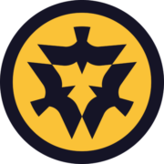

# 🌙 CAW Frontend 

<p align="center">
  <a href="https://caw.is">
      
  </a>  
  <br>
  <br>
  <strong>A decentralized social clearing house interface based on the CAW Manifesto.</strong>
</p>

---

## 📖 About the Project
CAW is not just a social network; it is a decentralized protocol designed for a free-speech-first environment. This repository contains the official frontend interface, built with modern web technologies to interact with on-chain smart contracts.

## 🚀 Live Environments
| Environment | Status | URL |
| :--- | :--- | :--- |
| **Mainnet** | ⏳ Coming Soon | Not yet |
| **Alpha Test UI** | 🟢 Active | [https://teh-eyes.vercel.app/](https://teh-eyes.vercel.app/) |

---

## 🛠 Tech Stack
This project is built using high-end industry standards for security and performance:
* **Framework:** [Next.js](https://nextjs.org/) & [TypeScript](https://www.typescriptlang.org/)
* **UI Library:** [Chakra UI](https://chakra-ui.com/)
* **Web3:** [Ethers.js](https://docs.ethers.io/v5/), [Wagmi](https://wagmi.sh/), & [RainbowKit](https://www.rainbowkit.com/)

---

## 💻 Installation & Development

### 1. Prerequisites
Ensure you have **Node.js** and **Yarn** installed.

### 2. Environment Setup
Create an `.env` file in the root directory and add your API keys:
```bash
ALCHEMY_API_KEY=YOUR_ALCHEMY_KEY
INFURA_API_KEY=YOUR_INFURA_KEY
JSON_RPC_URL="[https://rpc.builder0x69.io](https://rpc.builder0x69.io)"
NETWORK="goerli"
